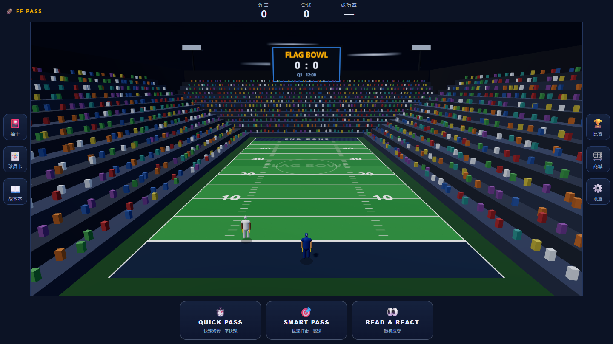

# Flag Football Pass — 腰旗橄榄球传球训练 🏈

Madden 风格的腰旗橄榄球传球训练网页游戏（PWA）：选战术 → 3D 球场 → 传球 → 接球判定。
手机浏览器即开即玩，可「添加到主屏幕」当 App 用；电脑上用鼠标滚轮缩放，手机上双指捏合缩放。



> **当前状态：可上线。** 构建、类型检查、46 条单测全绿；已配置 PWA 更新提示、GitHub Pages / Netlify / Vercel 部署方案。

---

## 1. 上线（让用户通过网页访问）

### 方案 A：GitHub Pages（免费、自带 CI）

1. 新建 GitHub 仓库，把本项目推上去：

   ```bash
   git init
   git add .
   git commit -m "feat: 可上线版本"
   git branch -M main
   git remote add origin https://github.com/<你的账号>/<仓库名>.git
   git push -u origin main
   ```

2. 仓库 **Settings → Pages → Build and deployment → Source 选 GitHub Actions**。
3. 之后每次 `git push`，`.github/workflows/deploy.yml` 会自动跑 `typecheck → test → build` 并发布。
4. 地址形如 `https://<账号>.github.io/<仓库名>/`，手机打开 → 浏览器菜单「添加到主屏幕」。

> 私有仓库要发布 Pages 需要 GitHub Pro；公开仓库免费。
> `vite.config.ts` 已设置 `base: './'`，放在子路径（`/仓库名/`）也能正常加载资源与 Service Worker。

### 方案 B：Netlify / Vercel / Cloudflare Pages（拖拽或连仓库，零配置）

- Netlify：仓库根目录的 `netlify.toml` 已写好（`npm ci && npm run build`，发布 `dist`）。
- Vercel：`vercel.json` 已写好（同样输出 `dist`）。
- Cloudflare Pages：构建命令 `npm run build`，输出目录 `dist`。
- 不想连仓库：本地 `npm run build`，把 `dist/` 整个文件夹拖到 Netlify Drop / Cloudflare 上传即可。

任何静态托管都行，**不需要后端**：游戏数据只存在浏览器 localStorage。

### 上线前建议自测清单

- [ ] 手机横屏进一次完整流程：选战术 → 等待跑位 → 轻点高球 / 长按平快球 → 结算
- [ ] 手机竖屏也能玩（会自动缩窄两侧按钮，顶部提示可关闭）
- [ ] 「添加到主屏幕」后全屏启动、断网重开仍能进（PWA 已预缓存代码与图标）
- [ ] 设置里能看到版本号与构建时间

---

## 2. 迭代与「用户点一下就更新」

发布流程就是 **改代码 → push**。CI 构建新版本并部署后：

1. 老用户下次打开页面时，Service Worker 检测到新版本 → 底部弹出 **「🚀 新版本已就绪 · 立即更新」**；
2. 用户点一下 → 新版本激活并自动刷新（`vite-plugin-pwa` 的 `prompt` 模式）；
3. 没点的用户继续用旧版本，不会被打断。

设置弹窗里还有 **版本号 + 构建时间 + 检查更新** 按钮，方便你和用户确认是否最新。
「已缓存，可离线游玩」提示只在首次安装缓存完成时出现。

> 想给用户发版说明：改 `package.json` 的 `version`，构建时会自动显示在设置里。

---

## 3. 本地开发

```bash
npm install
npm run dev        # http://localhost:5173
npm run typecheck  # tsc --noEmit
npm test           # Vitest（46 条）
npm run build      # 产出 dist/
npm run preview    # 本地预览构建产物
```

Windows 可双击 `start.bat`（自动装依赖并启动）。

手机联调：`npm run dev -- --host`，手机访问终端里的 Network 地址（同一 Wi-Fi）。

---

## 4. 玩法

1. 底部 **ACTION MENU** 三栏：QUICK PASS（短传）/ SMART PASS（纵深）/ READ & REACT（随机）。
   点开后在上方浮出战术卡片（带路线图），点卡片即开球。
2. WR 沿路线跑动，**点住 QB 传球**：
   - **轻点**（<250ms）＝ 高球 Lob：弧线高、滞空长 → 适合 Go / Post 深路线
   - **长按**（≥250ms，出现金色蓄力环）＝ 平快球 Bullet：快而直 → 适合 Slant / Hitch / Out
3. 掐时机：球按出手瞬间 WR 的跑动方向飞行。WR 停下超过 0.7s 未出手判「太晚了」。
4. 完美接球（跑动中接住）累计连击；传大/传短/传偏/太晚都会打断连击。
5. 右上「比赛」切换模拟比赛：随机站位 4 名防守球员，传球窗口被压缩，可能「被防守破坏」。

---

## 5. 3D 资产：用 Tripo 生成模型时选哪种？

**结论：网页版选「拓扑网格（Retopo / Game-ready）」，不要直接把高精度模型丢进网页。**

| | 高精度（High-poly） | 拓扑网格（Retopo） |
|---|---|---|
| 三角面 | 十几万 ~ 几百万 | 几千 ~ 3 万 |
| 用途 | 离线渲染、海报、影视 | 实时游戏 / 网页 / 手机 |
| 网页表现 | 手机掉帧、加载慢、发烫 | 流畅、包体小 |
| 贴图 | 常需烘焙法线 | 自带 PBR 贴图，直接用 |

推荐在 Tripo 里这样出资产：

- **球员**：拓扑网格，目标 **8k–15k 三角面**，贴图 **1024–2048**；单人 `.glb` ≤ 2 MB。
- **球场 / 看台**：拓扑网格，**3 万–8 万面**，贴图 2048；总 `.glb` ≤ 5 MB。
- 需要特写时，保留一份高精度源文件做「法线烘焙」：高模烘到低模的法线贴图上，网页里用低模显示，细节不丢。
- 导出设置：**GLB + 嵌入贴图**，避免 `.gltf + .bin + 一堆 jpg`；不要导出 4K 贴图（手机显存吃不消）。
- 生成后用 `gltf-transform` 再压一道（可选）：

  ```bash
  npx @gltf-transform/cli optimize in.glb out.glb --compress draco --texture-compress webp
  ```

  压缩后记得让加载器支持 Draco（`DRACOLoader`）；不用 Draco 也能跑，只是包体大一点。

### 模型怎么接进游戏

| 资产 | 放哪里 | 说明 |
|---|---|---|
| 头盔 | `public/models/helmet.glb` | 已接入，自动缩放到头围 0.62yd、按球队主色给外壳调色 |
| 全身球员 | `public/models/player.glb` | 把 `src/config.ts` 的 `PLAYER_MODEL_URL` 改成 `'./models/player.glb'`，自动归一到 1.92yd 身高、脚底贴地、正面朝 +z |
| 替代头盔 | 任意 | URL 参数临时覆盖：`?player=./models/p1.glb&helmet=./models/h2.glb` |

球员模型建议 **T-pose 或 A-pose、正面朝 +z、脚底在 y=0**（loader 也会按包围盒自动纠正）。
静态模型运行时会用轻微起伏代替跑动动画；想要真正的跑步动作，需要给模型绑骨骼并在 Blender/Mixamo 里做动画，再导出带 animation 的 glb（本项目暂未接动画混合器）。

> 仓库里的 `public/models/stadium.glb` 是一个**封闭式体育馆**（四面高墙 + 顶棚），相机在里面一定会被墙挡住，所以**默认不加载**。
> 现在的看台是程序化生成的开放式碗形（只放在远端和两侧，近端留空），任何缩放档位都不会挡镜头。
> 如果要用 Tripo 重做球场，请生成**开放式碗形、中心是空场地、四周看台向外升高**的模型，再按 `src/three/stadium.ts` 里 `loadStadium()` 的注释接入。

---

## 6. 项目结构

```
src/
├── core/        types.ts（类型+状态）/ stateMachine.ts（状态机，纯逻辑）
├── gameplay/    routes / ballPhysics / catchJudge / routeRunner / playDirector（纯逻辑，可单测）
├── data/        plays.ts（战术库）/ cards.ts（球员卡+抽卡）/ storage.ts（localStorage）
├── three/       dimensions / scene（球场+球员+天空）/ stadium（看台+模型加载）/ camera / renderer
├── ui/          playCall（战术菜单）/ gestures（轻点vs长按）/ modals / sideButtons
├── pwa.ts       Service Worker 注册 + 更新提示
├── config.ts    模型路径配置（可用 URL 参数覆盖）
└── main.ts      装配：状态机 ↔ 渲染 ↔ 手势 ↔ UI
```

游戏逻辑（`gameplay/`、`core/`）与渲染彻底分离，全部可单元测试；渲染层只做画面同步。

---

## 7. 性能与适配

- 画质：高 = 设备像素比（≤1.75）；低 = 1x。设置里可切换，**连续掉帧时会自动降档一次**并记住。
- 人群用 `InstancedMesh`（1 个 draw call），看台合并成 1 个网格，球场地贴 1 张 canvas 纹理。
- 页面切到后台会暂停渲染，回来不会瞬移。
- 安全区：`env(safe-area-inset-*)` 已处理刘海屏/圆角屏，横竖屏都可玩，竖屏顶部有「横屏体验更佳」提示（可关闭）。
- WebGL 2 不可用时会显示友好提示而不是白屏。

## 8. 已知限制 / 路线图

- [ ] 球员骨骼动画（当前是几何体摆臂 + 静态模型起伏）
- [ ] 防守球员 AI（现在是随机站位 + 接球点判定）
- [ ] 多外接手 + 滑动选择传球目标
- [ ] 音效/背景乐（音量设置已预留）
- [ ] 商城实装：球衣颜色/装备/球场主题
- [ ] 完整比赛模式：档数推进、达阵计分

## 9. 资产许可

- `public/models/helmet.glb`：Poly Pizza（CC0）
- `public/models/stadium.glb`：Poly Pizza（CC0），当前不参与渲染
- 其余球场/球员/UI 均为程序化生成，无第三方版权风险
